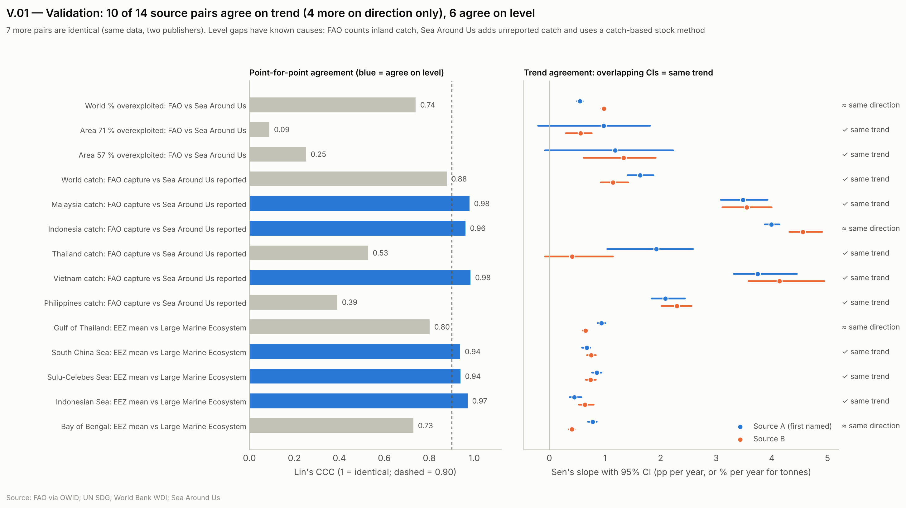
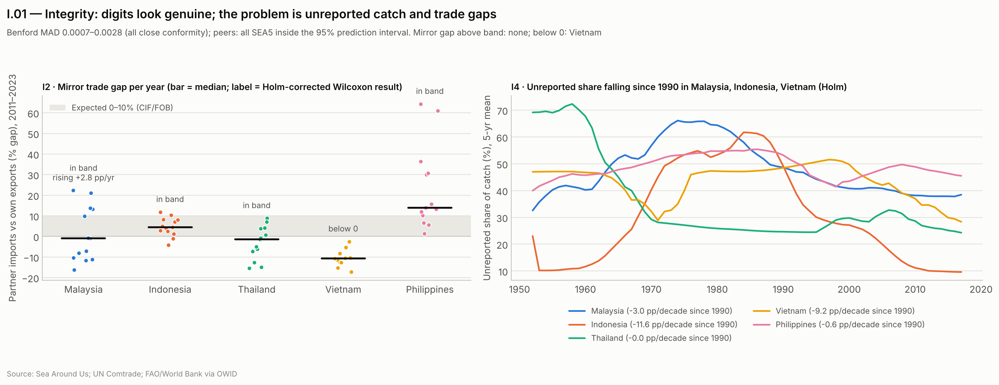

# 0-data-quality — Step 0: check and clean the data before any analysis

This is the **first step of the pipeline** and covers the **Data Understanding & Preparation** part of the rubric. It is the only step that reads `data/raw/`; every later step reads what it writes and will not run until its checks have passed.
- **Checked copies** of every input file in [`data/processed/clean/`](../data/processed/), and the cleaned, analysis-ready tables in [`data/processed/`](../data/processed/).
- **The gate:** if any check fails, the script exits with an error and the pipeline stops.
- Formal tests that the main data agree with alternative sources.
- Formal tests that the officially reported catch is plausible.

```bash
python run_all.py                          # whole pipeline, starting here
python 0-data-quality/clean_data.py        # -> data/processed/clean/, data/processed/*.csv, cleaning_log.csv, pass marker
python 0-data-quality/quality_tests.py     # -> results/*.csv + figures/*.png
```

## 1. Checks and cleaning (`clean_data.py`)

**Stage A: every raw file (79 CSVs).** Each file is checked, cleaned and written to the same path under `data/processed/clean/` with the same columns. Lines that need no change are copied byte for byte, so values are exactly the raw values.

| Check / rule | What is done | Result |
|---|---|---|
| C1 parses | The file reads as a table with at least one row | 79 of 79 pass |
| C2 duplicates | No exact-duplicate rows (a repeated download or append) | 0 |
| C3 infinite values | No ±inf (division artefacts in a source) | 0 |
| C4 missing values | Counted per file; reported, not a failure (several series are biennial or start late by design) | in `cleaning_log.csv` |
| R1 harmonise | "Viet Nam" → "Vietnam" in IMAS effort, ERSST SST (2 files), UN SDG and World Bank | 240 cells in 5 files |
| R5 drop partial year | World SST anomaly 2026 (only some months observed) | 1 row |
| R4 remove not-yet-real values | GDAT dams with a completion year after 2025 (planned, not built) | 6 rows |

A failure in C1–C3, or in the R6 table checks below, stops the pipeline. If everything passes, `data/processed/clean/_quality_checks_passed.json` records the SHA-256 of every raw file. If `data/raw/` changes afterwards, steps 1–4 refuse to run until this script runs again (`require_checked_data()` in [`src/loaders.py`](../src/loaders.py)).

**Stage B: tidy tables, built from the checked copies.**

| Rule | What is done | Logged count |
|---|---|---|
| R1 harmonise | "Viet Nam" (SAU, IMAS, ERSST) → "Vietnam" (OWID) | all tables |
| R2 derive | % overexploited = collapsed + over-exploited; unreported, foreign-fleet and industrial shares; catch per unit effort | every row |
| R3 aggregate | Country: % overexploited = mean of its EEZs; mean trophic level and shares = catch-weighted. SEA: mean of the 5 countries; catch and effort summed; SST area-weighted | 456 country-years |
| R4 flag, don't delete | 5 FAO world years that look interpolated; 3 effort source-break years (Thailand 2002, 2011; Malaysia 1965). 2 UN SDG values after 2021 are excluded (FAO 2025 method change) | 5 / 3 / 2 |
| R5 keep missing | Biennial series (SDG 14.7.1, FAO areas) are not interpolated; the partial year 2026 is dropped | 422 empty SDG cells |
| R6 checks | Duplicate keys, 0–100 range for percentages, ≥ 0 for amounts, missing values per column | **0 violations** |

The outputs are documented in [`data/processed/README.md`](../data/processed/README.md). Every rule and check is listed with its count in `cleaning_log.csv`.

## 2. Validation against alternative sources (`quality_tests.py`, section V)

For every source pair on common years, the script runs these tests:
- **Systematic difference:** a paired t-test if the differences pass Shapiro-Wilk, otherwise Wilcoxon signed-rank.
- **Bland-Altman** bias and limits of agreement. For tonnes they are in % of the pair mean.
- **Lin's CCC**, which measures point-for-point agreement.
- **Spearman ρ** on levels and on first differences.
- **Sen's slope + 95% CI** for each source.

**Verdict rules:**
- **Agree on level:** CCC ≥ 0.90.
- **Agree on trend:** the two Sen CIs overlap.
- **Same direction, different rate:** the CIs don't overlap, but both exclude 0 on the same side.

| Pair | n | Bias (LoA) | CCC | Verdict |
|---|---|---|---|---|
| World % overexploited: OWID vs UN SDG | 48 | 0 | 1.00 | identical (same data) |
| World % overexploited: FAO vs Sea Around Us | 46 | −4.1 pp (−17.7, +9.4) | 0.74 | differ in level; same direction, SAU rises faster (+0.98 vs +0.55 pp/yr) |
| Area 71: FAO vs Sea Around Us | 9 | −16.3 pp | 0.09 | differ in level; agree on trend |
| Area 57: FAO vs Sea Around Us | 9 | −9.4 pp | 0.25 | differ in level; agree on trend |
| Capture, World + 5 countries: OWID vs World Bank | 65 each | 0 | 1.00 | identical (same data) |
| World catch: FAO vs SAU reported | 60 | +6.1% | 0.88 | differ in level; agree on trend |
| Malaysia / Vietnam catch: FAO vs SAU reported | 60 | −6.8% / +9.8% | 0.98 / 0.98 | agree on level and trend |
| Indonesia catch: FAO vs SAU reported | 60 | +19.5% | 0.96 | agree on level; same direction, different rate |
| Thailand / Philippines catch: FAO vs SAU reported | 60 | +30.9% / +55.9% | 0.53 / 0.39 | differ in level; agree on trend (FAO includes inland catch) |
| EEZ mean vs Large Marine Ecosystem, 5 seas | 70 each | −3.2 to +8.4 pp | 0.73–0.97 | 3 agree on level and trend; Gulf of Thailand and Bay of Bengal same direction only |

**Conclusion:**
- **Same data, two publishers:** 7 pairs are identical.
- **Different sources:** of the 14 pairs from different sources, 10 agree on trend and 4 more on direction. None runs the opposite way.
- **Level gaps have known causes:**
  - FAO capture includes inland catch, which is why Thailand and the Philippines are far above Sea Around Us.
  - Sea Around Us stock status is catch-based, so its overexploitation share sits higher than FAO's.
  - FAO's area figures are biennial with only 9 common years, which explains the low CCC for Areas 71 and 57.
- **Implication for the analysis:** the analysis relies on trends and changes, not on absolute levels. All trend conclusions are robust to the choice of source.



## 3. Data integrity (`quality_tests.py`, section I)

| Test | Result |
|---|---|
| **I1 Benford** (MAD per country × reported/unreported) | All 10 groups are in "close conformity" (MAD 0.0007–0.0028; Nigrini threshold 0.006). No sign of invented numbers. |
| **I2 Mirror trade** (one-sample Wilcoxon on 2011–2023 yearly gaps, Holm across countries) | **Vietnam:** median −10.8%, significantly below 0 (Holm p = 0.001), which points to re-exports or transshipment. **Philippines:** median +13.9%, above the 10% band but not significant after Holm (p = 0.14, n = 13). **Malaysia:** median −1%, but the gap is widening by +2.8 pp/yr (Holm p = 0.02). Indonesia and Thailand are within the normal 0–10% CIF/FOB band. |
| **I3 Peer outliers** (log-log regression across 97 countries in 2021 and 84 in 2023, R² 0.73–0.76) | Every SEA5 country is inside the 95% prediction interval in both years (z +0.4 to +1.4). Fisheries value added is consistent with the reported catch. |
| **I4 Unreported share** (Hamed-Rao Mann-Kendall, Holm) | Falling significantly since 1990 in Indonesia (−11.6 pp/decade), Vietnam (−9.2) and Malaysia (−3.0). Flat in Thailand and the Philippines. The Philippines (45%) and Malaysia (38%) still have the largest gaps in 2015–19. |
| **I5 Do the signals agree?** (Spearman across 5 countries) | No: \|ρ\| ≤ 0.7, all p ≥ 0.19 (n = 5, exact p). The integrity signals measure different things, so no single country is flagged by all of them. |

**Conclusion:**
- **The reported numbers look genuine:** they pass the Benford check and the comparison with peer countries.
- **The reliability problem is incompleteness:**
  - **Unreported catch:** 10–45% of catch is unreported. Reporting is improving in Indonesia, Vietnam and Malaysia.
  - **Trade gaps:** Vietnam shows a consistent re-export pattern, and Malaysia's gap is widening.
- **Main findings unaffected:** the analysis uses Sea Around Us reconstructed totals, which include the unreported catch, so its main findings do not depend on official reporting quality.



## Why these methods
- **Bland-Altman for tonnes uses % of the pair mean.** Catch spans 1 to 90 million tonnes, and an absolute bias would be dominated by the World series.
- **CCC instead of Pearson for "agree on level".** Pearson ignores a constant offset; CCC penalises it.
- **Sen's slope on log tonnes,** so trends are compared in % per year whatever the size of the country.
- **One-sample Wilcoxon for the mirror gap.** There are only 13 yearly values and some extreme years (Philippines 2011–12 above +60%), so the median is more reliable than the mean.
- **Prediction interval instead of a plain z-score** for the peer test. It accounts for uncertainty in the fitted line and for how far a country sits from the average catch.
