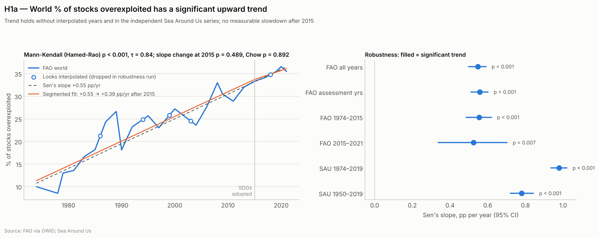
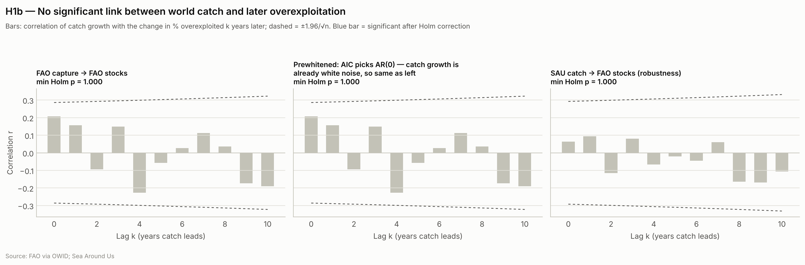
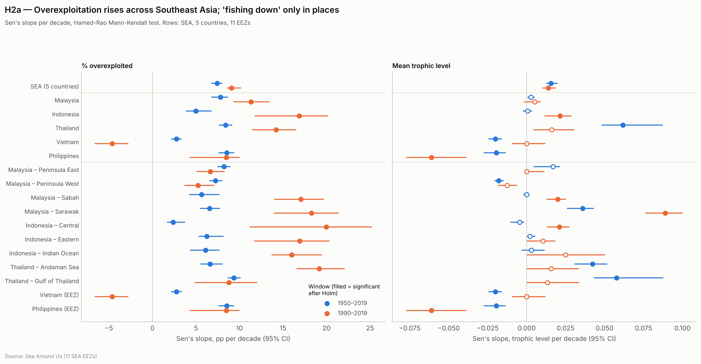
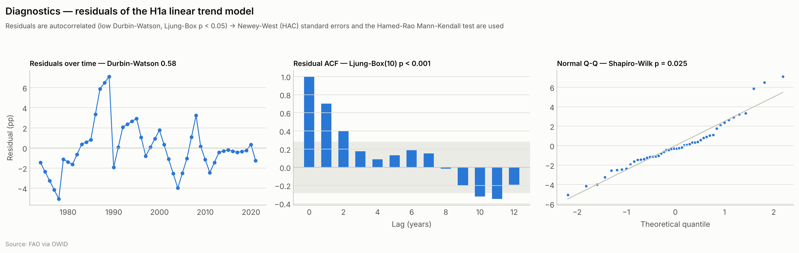

# 2-hypothesis-tests — Formal tests of H1a, H1b, H2a, H2b, H2c

`hypothesis_tests.py` runs the analysis pipeline from the main README (§4) on `data/raw/`. It reuses the data builders from [`1-statistical-tests/stat_tests.py`](../1-statistical-tests/stat_tests.py) and the chart style from [`0-visualisation/visualise.py`](../0-visualisation/visualise.py).

```bash
python 2-hypothesis-tests/hypothesis_tests.py                 # everything (~10 s)
python 2-hypothesis-tests/hypothesis_tests.py --only h1a h2c
```

Outputs:
- `results/decisions.csv`: verdict per hypothesis.
- `results/*.csv`: one table per test family.
- `figures/<section>/*.png`: 6 figures.

## Verdicts

| Hypothesis | Verdict | Key evidence |
|---|---|---|
| **H1a** World trend | **Reject H₀**: significant upward trend | Hamed-Rao Mann-Kendall p < 0.001, τ = 0.84; Sen's slope **+0.55 pp/yr** [0.50, 0.59]. Same result on assessment years only (+0.56) and in Sea Around Us (+0.98 pp/yr, 1974–2019). |
| | No slowdown after the SDGs | Slope changes −0.15 pp/yr after 2015 (p = 0.49); Chow test p = 0.89 |
| **H1b** World catch → overexploitation | **Fail to reject H₀** | CCF of catch growth vs Δ% overexploited, lags 0–10: max \|r\| = 0.23, all Holm p = 1.00. Prewhitened, Granger (lags 1–4) and the Sea Around Us catch series give the same result. Levels are not cointegrated (p = 0.20). |
| **Stage rule** | **Not met** (H1a yes, H1b no) | Stage 2 below is therefore **exploratory/conditional**, as the plan requires |
| **H2a** SEA trend | **Reject H₀**: % overexploited rises | SEA +7.4 pp/decade (p < 0.001); all 5 countries and all 11 EEZs rise over 1950–2019 after Holm. Since 1990 Vietnam is the only exception (falling). |
| | Mean trophic level: mixed | Falls significantly only in the **Philippines** (both windows), and in Vietnam and Malaysia Peninsula West over 1950–2019. SEA-wide MTL rises. |
| **H2b** SEA catch → MTL | **Fail to reject H₀** | 0 of 66 lag tests significant after Holm. The smallest raw p is the Philippines at lag 9 (r = −0.31, p = 0.016 → Holm 0.18). |
| **H2c** SEA vs world slope | **Mixed** | SEA as a whole rises at the world's pace since 1990: +0.97 vs +0.97 pp/yr, difference 0.00 [−0.09, +0.08], p = 0.91. |
| | Three countries worse | **Indonesia (+0.97 pp/yr faster), Thailand (+0.42), Malaysia (+0.26)** worsen significantly faster than the world (Holm). Vietnam is slower (−1.41) and the Philippines are not different. |
| | FAO Area 71 | Rises faster than the world (+1.03 pp/yr, p = 0.027), but only because of the 2021 value (without it p = 0.084). |

**Reading this:**
- Overfishing is clearly rising, globally and in Southeast Asia, and the SDGs have not bent the curve.
- *Catch volume* does not explain the rise, because world catch has been flat since the 1990s. Catch is a weak proxy for fishing pressure (README caveat 1); effort or fleet-capacity data would be needed to test the cause properly.
- Within SEA, the problem is concentrated in Indonesia, Thailand and Malaysia.

## Sections

| Section | Tests | Table(s) | Figure |
|---|---|---|---|
| Stationarity | ADF (H₀ unit root) + KPSS (H₀ stationary) on levels and on the transformation used: first difference / log-difference, detrended if ADF still fails | `0_stationarity_adf_kpss.csv` | — |
| H1a | Mann-Kendall (original + Hamed-Rao), Sen's slope + 95% CI, OLS + Newey-West, segmented regression (break 2015), Chow test | `1_H1a_*.csv` | H1a.01 |
| H1b | CCF lags 0–10 + Holm, AR prewhitening, Granger (F-test, lags 1–4), Engle-Granger cointegration | `2_H1b_*.csv` | H1b.01 |
| H2a | Hamed-Rao Mann-Kendall + Sen's slope for SEA, 5 countries and 11 EEZs × 2 windows, Holm per family; FAO Areas 71/57 | `3_H2a_*.csv` | H2a.01 |
| H2b | CCF catch growth → ΔMTL for SEA + 5 countries, Holm within unit and across all 66 tests | `4_H2b_ccf_catch_mtl.csv` | H2b.01 |
| H2c | Interaction regression y = b0 + b1·year + b2·SEA + b3·year×SEA; b3 tested on the SEA − world gap with HAC errors | `5_H2c_interaction_gap_regression.csv` | H2c.01 |
| Diagnostics | Shapiro-Wilk, Durbin-Watson, Ljung-Box, Breusch-Pagan for every regression | `6_regression_diagnostics.csv` | D.01 |

## Figures

| | |
|---|---|
|  |  |
|  |  |
|  |  |

## Notes for the report

- **Autocorrelation:** the H1a residuals have Durbin-Watson 0.58 and Ljung-Box p < 0.001, and 8 of the 13 regressions fail Ljung-Box. That is why every regression uses HAC standard errors and every trend uses the Hamed-Rao Mann-Kendall test.
- **Non-normal residuals:** these occur in the H1a and SEA-gap regressions (Shapiro p < 0.05). This supports Mann-Kendall / Sen as the primary trend evidence; OLS is the secondary check.
- **KPSS disagreements:** 7 transformed series pass ADF but not KPSS (flagged in the stationarity table). The CCF results there are the least certain, but none was close to significance.
- **SEA aggregate:** % overexploited is the mean of the 5 countries, so each country counts equally. A mean over the 11 EEZs would give Malaysia (4 EEZs) and Indonesia (3) more weight, and SEA would then look worse than the world.
- **FAO Area 71 vs world:** this comparison uses only 10 assessment years. The 2021 value (47%, up from 20% in 2019) drives the significance.
