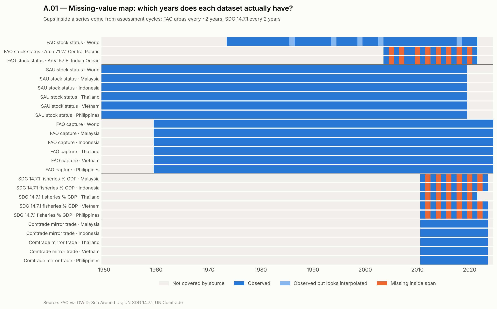
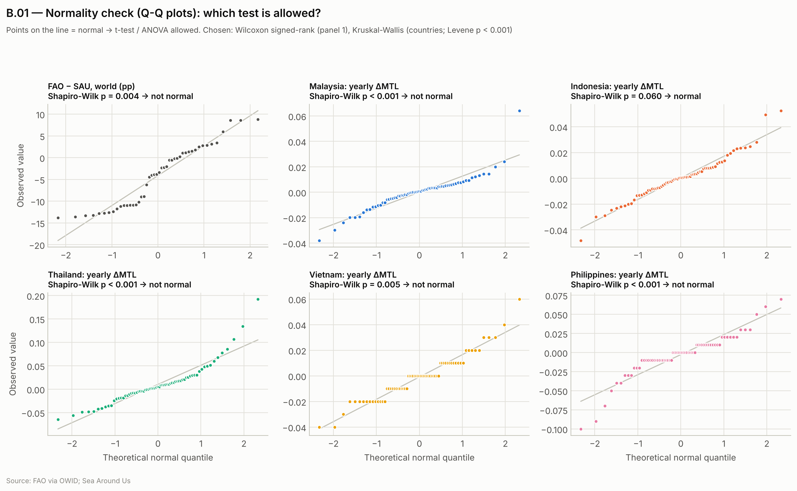
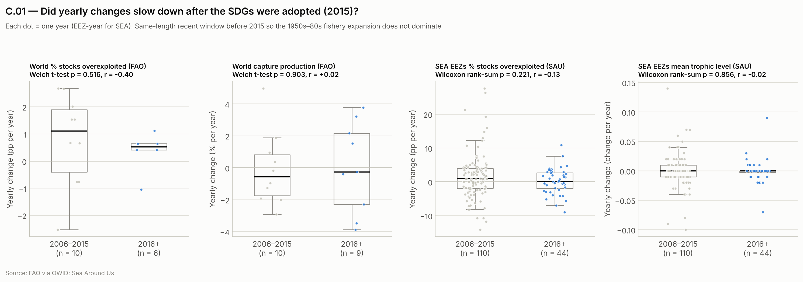
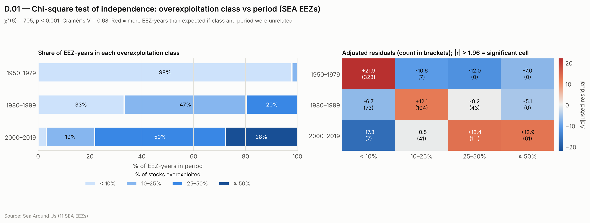
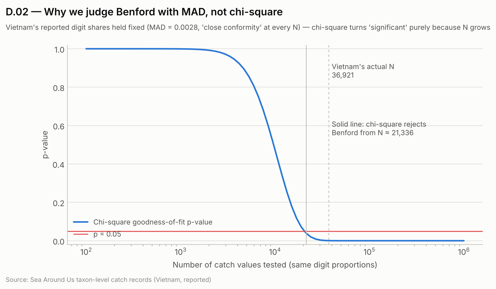
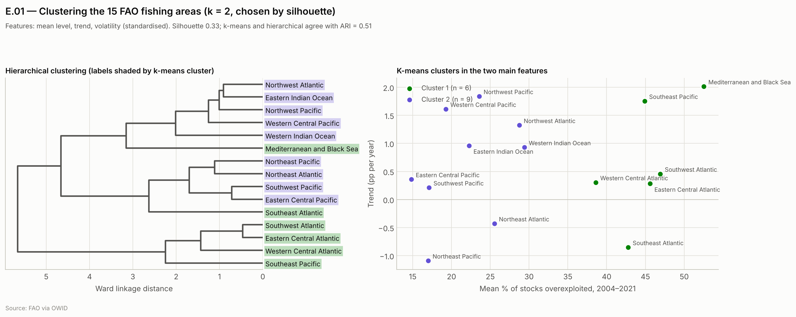
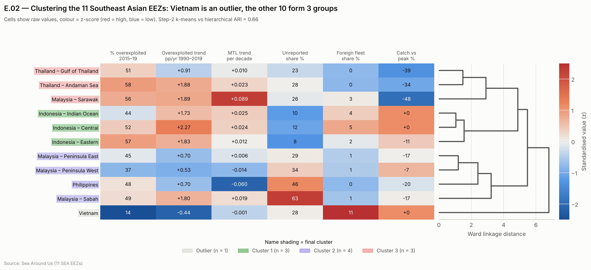
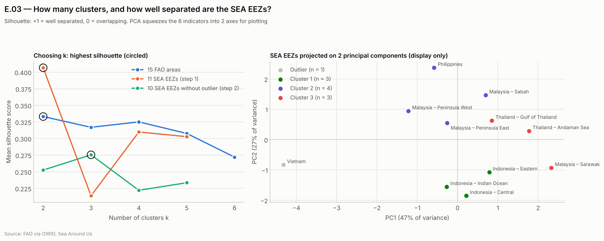

# 2-statistical-tests — Course methods applied to the SDG 14 data

`stat_tests.py` applies the KIE4033 week 6–7 methods (EDA, hypothesis testing, chi-square, unsupervised learning) to the checked data written by step 0 ([`data/processed/`](../data/processed/); it will not run until [`0-data-quality`](../0-data-quality/) has passed). It uses the shared data loaders and chart style in [`src/`](../src/).

```bash
python 2-statistical-tests/stat_tests.py                          # all sections (~10 s)
python 2-statistical-tests/stat_tests.py --only chisquare clustering
```

Outputs:
- `results/*.csv`: one table per test.
- `results/test_summary.csv`: one line per test (statistic, p, effect size, conclusion).
- `figures/<section>/*.png`: 8 figures.

> **Read p-values with care.** Yearly values of one series are not independent (autocorrelation), and most textbook tests assume they are. So p-values here are optimistic. Every test also reports an **effect size** (Cohen's d, eta², rank-biserial r, Cramér's V, silhouette), and the effect size is the main result.

## Course topic → section

| Course topic (slides) | Section | What is tested |
|---|---|---|
| EDA: tabular summaries, outlier detection | **A1** | n, mean, SD, quartiles, skewness for 23 series; Tukey IQR fences on levels and on yearly changes |
| EDA: missing value analysis | **A2**, fig A.01 | Coverage and gaps of 24 series, 1950–2024; years where FAO interpolated |
| EDA: frequency distribution tables | **A3** | SEA EEZ-years by % of stocks overexploited (4 classes) × period |
| Hypothesis testing: Student t-test vs Wilcoxon | **B1**, fig B.01 | Shapiro-Wilk on the paired differences decides: paired t-test or Wilcoxon signed-rank |
| Hypothesis testing: ANOVA | **B2**, fig B.01 | Shapiro-Wilk per group + Levene decide: one-way ANOVA, Welch ANOVA or Kruskal-Wallis (Dunn / Tukey post-hoc only if significant) |
| Hypothesis testing: Wilcoxon rank-sum | **C1**, fig C.01 | Yearly changes 2006–2015 vs 2016+ (Mann-Whitney U, with Welch t-test when both groups are normal) |
| Testing a correlation: chi-square | **D1–D3**, figs D.01–D.02 | Chi-square test of independence + Cramér's V + Cochran's rule + permutation p |
| Unsupervised learning: K-means, hierarchical clustering | **E1–E3**, figs E.01–E.03 | Ward hierarchical clustering and k-means on standardised indicators; k chosen by silhouette; agreement measured by adjusted Rand index (ARI) |

**Not used:** DBSCAN, logistic regression, decision tree and Naïve Bayes. With 5 countries × ~70 strongly autocorrelated years there are too few independent, labelled rows for classifiers. Vietnam's outlier status is already found by the clustering step.

## Figures

| Figure | Shows |
|---|---|
|  | **A.01 Missing-value map.** Only 7 series have internal gaps, and all come from reporting cycles: FAO areas 71/57 are assessed about every 2 years (44% of years missing); SDG 14.7.1 is published every 2 years (≈46% missing; Thailand has no 2023 value). 5 years of the FAO world series lie exactly on a straight line between their neighbours (likely interpolated). |
|  | **B.01 Q-Q plots.** Only Indonesia's ΔMTL passes Shapiro-Wilk. Non-parametric tests are therefore used for both comparisons. |
|  | **C.01 Before vs after 2015.** No significant change in any of the 4 indicators. |
|  | **D.01 Chi-square: class × period.** Strong association (V = 0.68). |
|  | **D.02 Chi-square and sample size.** Shows why Benford conformity is judged by MAD. |
|  | **E.01 FAO areas clustered.** |
|  | **E.02 SEA EEZs clustered.** Includes the indicator heatmap. |
|  | **E.03 Silhouette and PCA.** Silhouette vs k, and a PCA map of the EEZs. |

## Results

### A — Data profiling
- **Missing values:** no data loss. Every gap is a reporting cycle (FAO area assessments, SDG 14.7.1 every 2 years). Never interpolate SDG 14.7.1 onto yearly series; compare on reported years only.
- **Outliers (IQR):** level outliers mostly mark regime shifts, not errors:
  - Indonesia's % overexploited for 2008–19 (a late jump to ~50%)
  - Thailand's 1950–62 MTL and unreported share (early-record values)
  - Philippines' MTL for 2011–19 (a recent drop)
  
  Many Sea Around Us series change in small steps, so the IQR of yearly changes is narrow and flags many years. Check flagged years against the figures before treating them as errors.

### B — Assumption checks decide the test
| Comparison | Normal? | Test used | Result | Effect size |
|---|---|---|---|---|
| FAO vs SAU, world % overexploited (46 paired years) | No (Shapiro p = 0.004) | Wilcoxon signed-rank | p < 0.001: systematic difference, FAO lower by 4.1 pp on average | r = −0.58 (large) |
| Yearly ΔMTL across 5 countries | 4 of 5 groups no; variances unequal (Levene p < 0.001) | Kruskal-Wallis | H = 4.70, p = 0.32: no difference between countries | ε² = 0.014 (negligible) |

**Why the check matters:** a plain one-way ANOVA on the same ΔMTL data gives p = 0.033, i.e. "the countries differ". That comes from Thailand's much larger variance. Welch ANOVA (p = 0.31) and Kruskal-Wallis (p = 0.32) both say no difference.

### C — Before vs after 2015 (rank-sum)
| Indicator | n before / after | Test | p | r (rank-biserial) |
|---|---|---|---|---|
| World % overexploited (FAO) | 10 / 6 | Welch t (both normal) | 0.52 | −0.40 (slower after, not significant) |
| World capture % change | 10 / 9 | Welch t | 0.90 | +0.02 |
| SEA EEZ % overexploited (SAU) | 110 / 44 | Mann-Whitney U | 0.22 | −0.13 |
| SEA EEZ mean trophic level | 110 / 44 | Mann-Whitney U | 0.86 | −0.02 |

There is **no detectable change after the SDGs** in any indicator. The world rate of increase looks slower (median +1.1 → +0.5 pp/yr), but 6 post-2015 years are too few to show it. This supports H1a: overexploitation keeps rising.

The comparison uses 2006–2015 as the "before" window (same length as "after") so that the 1950s–80s fishery expansion does not dominate.

### D — Chi-square tests of independence
| Test | n | χ² (df) | p | Cramér's V |
|---|---|---|---|---|
| D1 Overexploitation class × period (SEA EEZ-years) | 770 | 705 (6) | < 0.001 | **0.68** (strong) |
| D2 ≥ 50% overexploited × country (2010–19) | 110 | 29.1 (4) | < 0.001 (permutation p < 0.001) | **0.51** (strong) |
| D3 Leading digit × reported/unreported (per country) | 78k–784k | — | 0.92 to < 0.001 | 0.006–0.019 (negligible) |

- **D1:** 98% of EEZ-years in 1950–79 had < 10% of stocks overexploited. In 2000–19, 78% had ≥ 25% and 28% had ≥ 50%.
- **D2:** in 2010–19, Indonesia and Thailand are mostly ≥ 50%; Malaysia and the Philippines mostly below; Vietnam never reaches 50%. All expected counts are ≥ 4.5 (Cochran's rule met).
- **D3:** chi-square goodness-of-fit rejects Benford for 4 of 5 countries, but MAD (0.0007–0.0028) shows close conformity for all. Fig D.02 explains the disagreement: with Vietnam's digit shares held fixed, chi-square switches from "conforms" to "rejects" at about N = 21,000 values. The data has 37,000, so the rejection comes from sample size, not from the digits.

### E — Clustering
- **Global, 15 FAO areas:** 2 clusters (silhouette 0.33, ARI 0.51):
  - High overexploitation: Mediterranean & Black Sea, SE Pacific, SW/SE/W-Central/E-Central Atlantic.
  - The rest, lower overexploitation.
  
  **Area 71 (Western Central Pacific, SEA)** is in the lower-level group but has one of the steepest trends (+1.6 pp/yr), next to the NW Pacific.
- **SEA, 11 EEZs:**
  - Step 1 (k = 2, silhouette 0.41) isolates **Vietnam** as an outlier: the only EEZ with low overexploitation (14%), a falling trend, catch still at its peak, and the highest foreign-fleet share (11%).
  - Step 2 clusters the other 10 into 3 groups (silhouette 0.28, ARI vs hierarchical 0.66; weak-to-moderate structure):

| Cluster | Members | Profile (means) |
|---|---|---|
| 1 | Indonesia: Eastern, Central, Indian Ocean | Highest rise in overexploitation (+1.9 pp/yr), 51% overexploited, **lowest unreported share (10%)**, catch still near peak |
| 2 | Malaysia: Peninsula West, Peninsula East, Sabah; Philippines | 45% overexploited, slower rise (+0.9 pp/yr), **highest unreported share (43%)** |
| 3 | Malaysia: Sarawak; Thailand: Andaman Sea, Gulf of Thailand | **Most overexploited (55%)** and **catch 40% below peak**: the most depleted group |

The clusters cut across national borders. Malaysian EEZs fall into two different groups, so country-level averages hide real differences between sea areas.
