# 3-hypothesis-tests — Formal tests of H1a–H2c, plus H3 (warming), H4 (shipping & structures), H5 (panel, rebuilding, FiB, 2030 forecast) and H6 (drivers in combination)

`hypothesis_tests.py` runs the analysis pipeline from the main README (§4) on the checked data written by step 0 ([`data/processed/`](../data/processed/); it will not run until [`0-data-quality`](../0-data-quality/) has passed). Data loaders, chart style and shared statistics come from [`src/`](../src/).

```bash
python 3-hypothesis-tests/hypothesis_tests.py                 # everything (~2 min)
python 3-hypothesis-tests/hypothesis_tests.py --only h1a h2c
python 3-hypothesis-tests/hypothesis_tests.py --only i2_cpue i2_h1b i2_h2b   # iteration 2 (effort)
python 3-hypothesis-tests/hypothesis_tests.py --only i3_h3a i3_h3b            # iteration 3 (warming)
python 3-hypothesis-tests/hypothesis_tests.py --only i4_data i4_h4a i4_h4b i4_h4c i4_descriptive   # iteration 4
python 3-hypothesis-tests/hypothesis_tests.py --only i5_h5a i5_h5b i5_h5c i5_h5d   # iteration 5
python 3-hypothesis-tests/hypothesis_tests.py --only i6_h6a i6_h6b i6_h6c          # iteration 6 (combinations)
python 3-hypothesis-tests/hypothesis_tests.py --only summary                  # all drivers, one figure
```

Outputs:
- `results/decisions.csv`: verdict per hypothesis.
- `results/*.csv`: one table per test family.
- `figures/<section>/*.png`: 23 figures (6 for iteration 1, 3 + 2 + 4 + 4 + 3 for iterations 2–6, 1 summary).

## Verdicts

| Hypothesis | Verdict | Key evidence |
|---|---|---|
| **H1a** World trend | **Reject H₀**: significant upward trend | Hamed-Rao Mann-Kendall p < 0.001, τ = 0.84; Sen's slope **+0.55 pp/yr** [0.50, 0.59]. Same result on assessment years only (+0.56) and in Sea Around Us (+0.98 pp/yr, 1974–2019). |
| | No slowdown after the SDGs | Slope changes −0.15 pp/yr after 2015 (p = 0.49); Chow test p = 0.89 |
| **H1b** World catch → overexploitation | **Fail to reject H₀** | CCF of catch growth vs Δ% overexploited, lags 0–10: max \|r\| = 0.23, all Holm p = 1.00. Prewhitened, Granger (lags 1–4) and the Sea Around Us catch series give the same result. Levels are not cointegrated (p = 0.20). |
| **Stage rule** | **Not met** (H1a yes, H1b no) | Stage 2 below is therefore **exploratory/conditional**, as the plan requires |
| **H2a** SEA trend | **Reject H₀**: % overexploited rises | SEA +7.4 pp/decade (p < 0.001); all 5 countries and all 11 EEZs rise over 1950–2019 after Holm. Since 1990 Vietnam is the only exception (falling). |
| | Mean trophic level: mixed | Falls significantly only in the **Philippines** (both windows), and in Vietnam and Malaysia Peninsula West over 1950–2019. SEA-wide MTL rises. |
| **H2b** SEA catch → MTL | **Fail to reject H₀** | 0 of 66 lag tests significant after Holm. The smallest raw p is the Philippines at lag 9 (r = −0.31, p = 0.016 → Holm 0.18). |
| **H2c** SEA vs world slope | **Mixed** | SEA as a whole rises at the world's pace since 1990: +0.97 vs +0.97 pp/yr, difference 0.00 [−0.09, +0.08], p = 0.91. |
| | Three countries worse | **Indonesia (+0.97 pp/yr faster), Thailand (+0.42), Malaysia (+0.26)** worsen significantly faster than the world (Holm). Vietnam is slower (−1.41) and the Philippines are not different. |
| | FAO Area 71 | Rises faster than the world (+1.03 pp/yr, p = 0.027), but only because of the 2021 value (without it p = 0.084). |

**Reading this:**
- Overfishing is clearly rising, globally and in Southeast Asia, and the SDGs have not bent the curve.
- *Catch volume* does not explain the rise, because world catch has been flat since the 1990s. Catch is a weak proxy for fishing pressure (README caveat 1); effort or fleet-capacity data would be needed to test the cause properly.
- Within SEA, the problem is concentrated in Indonesia, Thailand and Malaysia.

## Iteration 2 — fishing effort as the pressure variable

Iteration 1 found no link between **catch** and overexploitation (H1b, H2b). Catch is only a proxy for fishing pressure (main README caveat 1). It can stay flat while pressure rises, if each unit of fishing lands less. Iteration 2 repeats H1b and H2b with **fishing effort**, the direct measure of pressure. The source is the IMAS Global Fishing Effort database (vessels × kW × days at sea, 1950–2017). Iteration-1 results above are kept unchanged, so the analysis history stays visible.

| Test | Result |
|---|---|
| **Catch per unit effort (CPUE)**, Mann-Kendall on log CPUE 1990–2017 | **Falling.** World −35% (1990–94 → 2013–17; effort +44%, catch −6%; Sen −1.9%/yr, p < 0.001). SEA −50% (Sen −3.6%/yr). Significant after Holm in Malaysia (−68%), Indonesia (−54%) and the Philippines (−43%). Not significant in Thailand (source breaks) or Vietnam (−12%, catch still growing). |
| **H1b with effort** (world effort growth → Δ% overexploited, lags 0–10) | **Fail to reject H₀.** Max r = +0.35 at lag 3 (raw p = 0.026 → Holm 0.29). Sea Around Us series: Holm min p = 0.27. Granger min Holm p = 0.07. Long-run cointegration p = 0.078 (with constant; 10% level only). |
| **H2b with effort** (EEZ effort growth → Δ% overexploited and ΔMTL, SEA + 5 countries) | **Weak.** 1 of 132 tests is significant within its unit: Indonesia ΔMTL, same year, r = +0.35 (Holm p = 0.043). It is not significant once all 132 tests are corrected together (p = 0.52). |
| **Stage rule** | Still not met: H1b is not rejected with either catch or effort. |

**What the second iteration adds:**
- **The long run explains the rise.** More effort is needed for the same or less catch, the classic sign of depleted stocks. That is why catch can stay flat (iteration 1) while overexploitation rises.
- **Short-run changes don't line up.** Stock status responds slowly and cumulatively, so a 0–10-year correlation of yearly changes cannot pick up the link.
- **Stock status becomes testable.** Effort, unlike catch, is independent of Sea Around Us stock status, which removes the circularity from iteration 1.

**Method choices:**
- **Nominal effort is the main series.** Effective effort includes an assumed technological creep, grows several hundred-fold and stays non-stationary, so it is used for sensitivity only.
- **Source breaks are removed.** Single-year jumps above 65% are dropped from the effort growth series (Thailand 2002 and 2011, Malaysia 1965). Thailand's series stays non-stationary even so, and its CCF is flagged as unreliable.
- **CPUE change uses 5-year means** (1990–94 vs 2013–17), so a single noisy year can't drive it.

| | | |
|---|---|---|
| 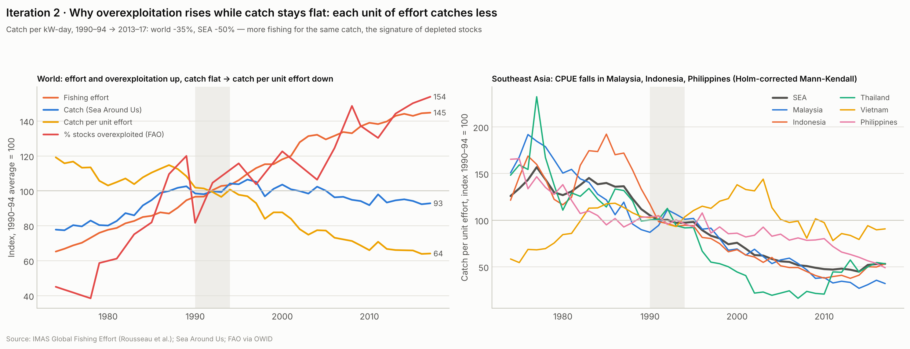 | 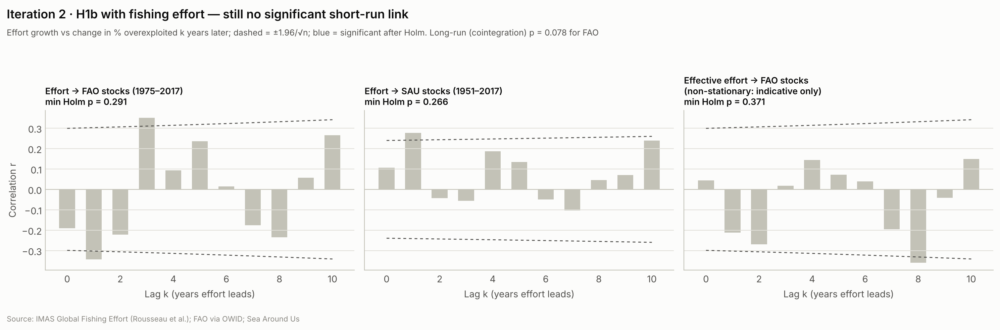 | 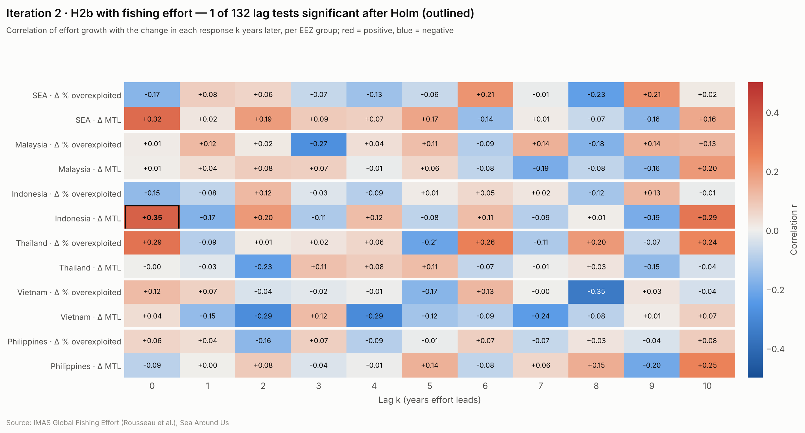 |

Tables: `7_I2_stationarity_effort.csv`, `7_I2_cpue_trends.csv`, `7_I2_H1b_ccf_effort.csv`, `7_I2_H1b_granger_effort.csv`, `7_I2_H1b_cointegration_effort.csv`, `7_I2_H2b_ccf_effort.csv`. Verdicts are rows in `decisions.csv`.

## Iteration 3 — ocean warming as an alternative driver (new hypothesis H3)

Neither catch nor effort explained the year-to-year pattern, so iteration 3 tests whether **ocean warming** lines up with overexploitation instead.
- **H3a (global):** world SST anomaly (HadSST) and upper-700 m ocean heat content (NOAA) vs world % overexploited (FAO, SAU).
- **H3b (SEA):** annual SST over each SEA5 EEZ (NOAA ERSST v5, area-weighted) vs SAU % overexploited, mean trophic level and catch.

| Test | Result |
|---|---|
| **Warming itself** (Mann-Kendall) | Every EEZ warms significantly (p < 0.001): SEA +0.12 °C/decade, range Vietnam +0.10 to Philippines +0.13. Months with unusually warm SST rose from 0.2/yr (1950–89) to 5.6/yr (1990–2025). |
| **H3a levels vs detrended** | Levels correlate strongly (ρ = +0.86 with FAO), but only because both rise. After removing linear trends: FAO ρ = −0.11 (p = 0.45) and SAU ρ = +0.44. The two sources disagree in sign. The SAU series is S-shaped, so a straight-line detrend leaves curvature that happens to match accelerating warming. |
| **H3a long run** (cointegration) | With a constant only: p = 0.051 (FAO), 0.033 (SAU). With a trend term: p = 0.36 (FAO). With SST and log effort together: p = 0.19 (FAO). The long-run "link" is the shared trend. |
| **H3a short run** (CCF lags 0–10, Granger 1–4) | Nothing significant: CCF min Holm p = 0.56 across SST and ocean heat content; Granger all Holm p = 1.00. **Fail to reject H₀.** |
| **H3b SEA CCF** (Δ SST → Δ% overexploited, ΔMTL, Δlog catch; 6 units × 3 responses × 11 lags = 198 tests) | **Weak.** 2 tests are significant within their row: SEA Δ% overexploited at lag 10 (r = +0.44, the edge of the tested range) and Indonesia ΔMTL at lag 4 (r = +0.36). Neither survives correction across all 198 tests (min p = 0.11). |

**What the third iteration adds:**
- The oceans in our region are warming clearly and measurably.
- But warming, effort and overexploitation all rise steadily, so these yearly series cannot tell them apart. A trend-on-trend correlation is expected whatever the true cause.
- Separating them would need stock-level data, e.g. species range shifts or recruitment vs temperature, or experiments. That is beyond an EDA assignment and belongs in the report's limitations.

**Method choices:**
- **Levels vs detrended:** shown side by side, to demonstrate why a raw correlation (ρ = 0.86) is not evidence.
- **Cointegration three ways** (with and without a trend term, and jointly with effort): this separates "they share a trend" from "they share a trend beyond time and fishing pressure".
- **SST per EEZ:** EEZ SST is weighted by the EEZ area inside each grid cell, not by a lat/lon box, so it covers the same sea area as the Sea Around Us data.

| | |
|---|---|
| 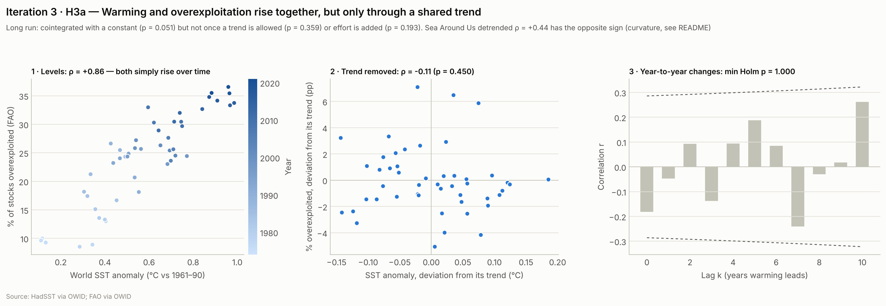 | 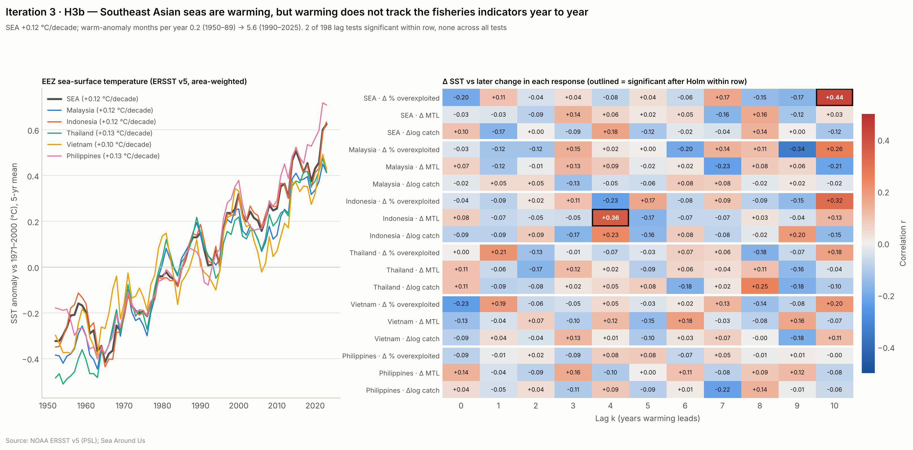 |

Tables: `8_I3_stationarity_warming.csv`, `8_I3_H3a_levels_vs_detrended.csv`, `8_I3_H3a_cointegration.csv`, `8_I3_H3a_ccf.csv`, `8_I3_H3a_granger.csv`, `8_I3_H3b_ccf_sea.csv`, `8_I3_H3b_sst_trends.csv`. Verdicts are rows in `decisions.csv`.

## Iteration 4 — shipping and built structures (new hypothesis H4)

None of catch, effort or warming linked to overexploitation beyond the shared upward trend. Iteration 4 tests human uses of the sea that grew over the same decades and could harm stocks through **habitat loss** rather than catch:
- **H4a (global):** container port traffic, seaborne trade volume, dams completed (cumulative) and aquaculture production vs world % overexploited (FAO, SAU).
- **H4b (SEA):** the same drivers plus the liner shipping connectivity index, per country and for SEA, vs SAU Δ% overexploited and ΔMTL.
- **H4c (SEA):** artificial islands and military outposts. These have no yearly series, only a dated event: China's Spratly reclamation, Dec 2013 – 2016 (>3,200 acres; outposts and airstrips built on the same reefs through 2018). The test is a difference-in-differences: the 4 EEZs facing the Spratlys (Vietnam, Philippines, Sabah, Sarawak) vs 5 other SEA EEZs, 2004–2019, event year 2014.
- **Offshore oil & gas platforms and wind farms:** satellite records start in 2017 and 2016, so they overlap the fisheries data (to 2019) by 3–4 years. That is too short for any test, so they are shown descriptively.

| Test | Result |
|---|---|
| **Drivers** | All grow steadily: world container traffic +5.8%/yr, seaborne trade +2.8%/yr (2000–2024), aquaculture +7.5%/yr (1960–2024), dams +3.6%/yr (cumulative, 1900–2019). Vietnam grows fastest (containers +13%/yr). |
| **H4a levels vs detrended** | Levels ρ = +0.93 to +1.00 for every pair, i.e. pure shared trend. Beyond the trend, nothing holds up: shipping correlates with SAU after a straight-line detrend (+0.85, +0.65) but not after a quadratic one (+0.38, +0.29, n.s.) and not with FAO (−0.13, −0.08). Dams correlate in both detrends but with **opposite signs** in FAO (+0.56) and SAU (−0.65). Aquaculture is significant only with SAU under a quadratic detrend. |
| **H4a long run** (cointegration, series ≥ 30 years) | Not cointegrated: dams p = 0.19 / 0.06 (FAO, constant / trend), aquaculture p = 0.18 / 0.33; SAU p ≥ 0.49. Shipping is too short to test (20–22 years). |
| **H4a short run** (CCF of growth rates, lags 0 to n/3) | 0 of 74 lag tests significant across all pairs (min Holm p = 0.30). One within-pair hit: aquaculture growth → Δ SAU % overexploited at lag 5, r = +0.39 (Holm p = 0.044 within the pair). **Fail to reject H₀.** |
| **H4b SEA CCF** (6 units × 5 drivers × 2 responses = 60 rows, 492 lag tests) | **Weak.** 2 tests significant within their row, both Thailand dam completions → ΔMTL at lags 6–7 (r = +0.46, +0.41). None across all 492 tests (min Holm p = 0.48). SEA detrended links (dams −0.59, aquaculture +0.65) flip sign or vanish under a quadratic detrend (+0.63, +0.22 n.s.). |
| **H4c island building** (DiD, randomization inference over all 126 ways to pick 4 of 9 EEZs) | **Fail to reject H₀.** % overexploited β = +0.70 pp (p = 0.91), MTL β = −0.03 (p = 0.48), log catch β = −0.08 (p = 0.59). Counting the SCS-edge EEZs (Peninsula East, Indonesia Central) as treated: β = +1.5 pp (p = 0.70). Placebo event in 2009: β = −8.0 pp (p = 0.29). The event study shows no break at 2014; only 2019 sits above zero (+11 pp), a single year. |
| **Platforms / wind** (descriptive) | SEA platforms are nearly flat 2017–2023 (Thailand 419 → 452, Malaysia 133 → 146, Vietnam 18 → 21). SEA's only offshore wind is a nearshore cluster in Vietnam (50 → 64 turbines, 2016–2021); world turbines 3,617 → 8,885. |

**What the fourth iteration adds:**
- Shipping, dams and aquaculture all grew alongside overexploitation, so their raw correlations look strong (ρ > 0.9), but every link disappears or changes sign once the trend is handled carefully. They join catch, effort and warming as **trend-only** associations.
- The quadratic detrend is a new robustness check. A real link should keep its sign whichever smooth trend is removed and in both data sources. None does. This also confirms the iteration-3 reading that the SAU detrended correlation came from curvature.
- **Island building** is the one driver with a clean before/after design, and it shows no effect on the neighbouring EEZs. The damage it does (AMTI estimates ~4,600 acres of reef buried by China, ~2,400 by Vietnam) is real but local. EEZ-wide stock indicators are too coarse to register it, and Vietnam's reclamation (2022–2025) falls after the data end.

**What could not be tested, and why:**
- **Military bases:** no dated time series exists. The Spratly outposts are covered by H4c, because they sit on the reclaimed features.
- **Artificial islands after 2019:** reclamation is documented only as milestone totals (AMTI reports), so there is no yearly series.
- **Offshore wind and platforms:** 3–4 overlapping years, so they are shown descriptively (figure I4.04).
- **Seaborne trade before 2000:** UNCTAD publishes only selected years (1970, 1980, 1990), so the shipping tests start in 2000.

**Method choices:**
- **Container series spliced:** the current WDI series starts in 2010. Years 2000–2009 come from the WDI Dec-2020 archive, rescaled by the median ratio over the 2010–2019 overlap (world ratio 0.994, growth correlation 0.90; table `9_I4_container_splice.csv`).
- **Lags limited to n/3** for short series, so every lag keeps at least two-thirds of the years.
- **Randomization inference for the DiD:** with 9 EEZs, clustered standard errors are unreliable, so the p-value comes from all 126 possible "treated" groups. The placebo year (2009) checks the pre-event trends.
- **Dams = cumulative dated completions:** 34% of GDAT dams (more than half in Indonesia, Thailand and Vietnam) have no completion year and are left out, so the series is a lower bound. GDAT completions also thin out after ~2005 because the database lags construction.

| | |
|---|---|
| 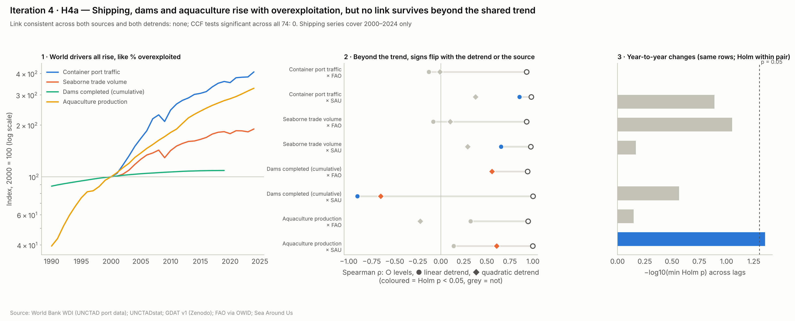 | 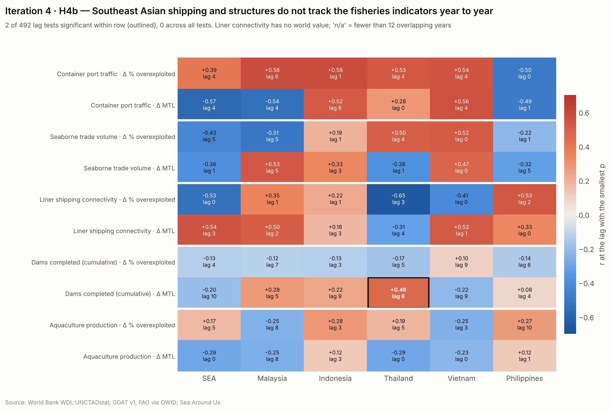 |
| 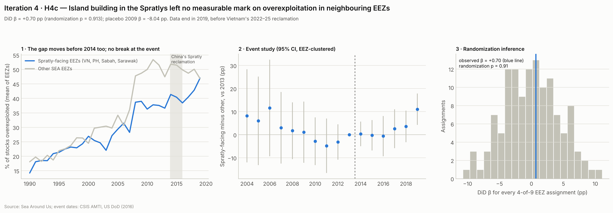 | 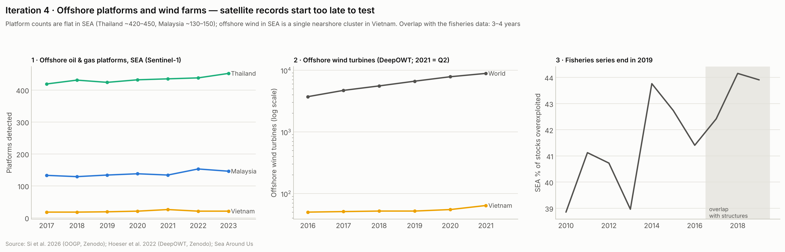 |

Tables: `9_I4_container_splice.csv`, `9_I4_driver_coverage.csv`, `9_I4_stationarity.csv`, `9_I4_H4a_levels_vs_detrended.csv`, `9_I4_H4a_cointegration.csv`, `9_I4_H4a_ccf.csv`, `9_I4_H4b_ccf_sea.csv`, `9_I4_H4b_levels_vs_detrended.csv`, `9_I4_H4c_did.csv`, `9_I4_H4c_event_study.csv`, `9_I4_structures_descriptive.csv`. Verdicts are rows in `decisions.csv`.

## Iteration 5 — more power, stock rebuilding, Fishing-in-Balance (new hypothesis H5)

Iterations 1–4 tested each driver on one short yearly series, so the obvious objection to every null result is low power. Iteration 5 answers that, and adds two questions the earlier iterations didn't ask:
- **H5a (pooled panel):** all 11 SEA EEZs in one regression (5 countries for effort), with EEZ and year fixed effects. Year effects remove the common upward trend, so a driver's effect comes from EEZs where pressure rose faster also worsening faster. Drivers: industrial, unreported and foreign-fleet shares of catch, fishing effort (break-adjusted), and catch (against mean trophic level only, because SAU stock status is derived from catch). Each is tested same-year and as the mean of the previous 5 years, with and without a linear trend per EEZ.
- **H5b (rebuilding, SDG 14.4):** SDG 14.4 also asks to *restore* stocks. Did the share of rebuilding stocks rise after 2015?
- **H5c (Fishing-in-Balance):** the FiB index (Pauly et al. 2000) asks whether catch still grows enough to offset any drop in trophic level. It explains why SEA mean trophic level rises while overexploitation also rises.
- **H5d (forecast to 2030):** on current trends, will the share of overexploited stocks be higher at the SDG deadline than today? World (FAO and SAU), SEA and the 5 countries.

| Test | Result |
|---|---|
| **H5a pooled panel** (36 coefficients, wild cluster bootstrap, Holm) | **Fail to reject H₀.** 0 of 36 significant. The smallest raw p is foreign-fleet share → % overexploited (standardised β = −0.38, raw p = 0.020, Holm 0.73), and its sign is the opposite of "foreign fleets cause it". Industrial share also leans negative. Clustered CIs exclude zero for some rows, but with 11 clusters those are too narrow; the bootstrap corrects that. |
| **H5b rebuilding** | **Mixed.** World: 6.4% → 8.5% of stocks rebuilding (2010–14 → 2015–19), slope +1.00 pp/yr faster after 2015 (p = 0.016). SEA: 9.0% → 9.3%, and the slope *fell* after 2015 (−0.43 pp/yr, p = 0.002). Across the 11 EEZs, 6 rose and 5 fell (one-sided Wilcoxon p = 0.26). Thailand rose (+1.66 pp/yr, Holm p < 0.001); Vietnam (−1.18) and the Philippines (−2.64) fell. |
| **H5c Fishing-in-Balance** (Mann-Kendall 1990–2019) | **Fail to reject H₀ for SEA: FiB is rising**, +0.15 per decade (p < 0.001). From 1990–94 to 2015–19 SEA FiB rose 0.39: catch contributed +0.32, trophic level +0.07. It is rising in Indonesia and Vietnam and **falling only in Thailand** (−0.10/decade, Holm p = 0.017; Gulf of Thailand −0.14, p = 0.006), where catch fell 30%. World FiB rose slightly (+0.05/decade) through trophic level while world catch fell. |
| **H5d forecast to 2030** (linear trend / damped ETS / ARIMA on logit %, model picked by a 5-year back-test) | **Reject H₀ for the world.** FAO world 35.5% (2021) → **41.3% in 2030** [95% PI 36.7–46.1]; the lower bound is above today's level in 2 of 3 models (linear 36.7, ARIMA 36.7; damped ETS 34.7). For SEA and most countries (SAU), a no-change forecast beat every trend model in the 2015–19 back-test: those series flattened, so the projected rises (SEA 43.9% → 53.5%) are not supported. The honest SEA reading is "no improvement by 2030", not "further rise". Vietnam is the only series projected to fall (20% → 16%, interval 6–37%). |

**What the fifth iteration adds:**
- **2030 outlook:** on its current path the world reaches ~41% overexploited by the SDG deadline, further from the target, not closer. SEA has levelled off at ~44% but shows no reversal.
- **Low power is not the explanation.** Pooling 770 EEZ-years with the common trend removed still finds no pressure effect. The null results reflect the data's resolution (EEZ-level, catch-based status), not too few years.
- **SDG 14.4 "restore" is missed in SEA.** Rebuilding picked up worldwide after 2015 but stalled in SEA, and fell in Vietnam and the Philippines.
- **The trophic-level puzzle is expansion.** SEA mean trophic level rises because catches are still growing into new grounds and higher-trophic (offshore, pelagic) stocks. That keeps FiB rising and hides depletion of the older fisheries. Thailand is the one country past that phase: catch and FiB are falling, which matches it being among the most overexploited and worsening faster than the world (H2c).

**Method choices:**
- **Two-way fixed effects** rather than pooled OLS: EEZ effects remove fixed differences between seas; year effects remove everything common to all EEZs, including the shared trend that confounded iterations 3–4. Adding a linear trend per EEZ is the stricter check.
- **Wild cluster bootstrap (Webb 6-point weights, null imposed):** standard clustered errors over-reject with 11 (or 5) clusters. With 5 clusters all 6⁵ = 7,776 weight draws are enumerated; with 11, 9,999 random draws.
- **Effort rebuilt without its source breaks** before entering a level regression, otherwise a statistical break would act as a permanent jump.
- **Paired Wilcoxon across EEZs** for the before/after-2015 comparison: 11 pairs, non-normal, one-sided because the SDG asks for an increase.
- **Forecast on the logit scale:** keeps forecasts and intervals inside 0–100%. Three model families (a supervised-regression trend, damped exponential smoothing, ARIMA) compete in a 5-year back-test; a projected rise only counts if the chosen model also beats a no-change forecast, which guards against extending a trend that has already flattened.
- **FiB with TE = 0.1** (the standard transfer efficiency), baseline 1950, natural log (the base only rescales the index).

| | | |
|---|---|---|
| 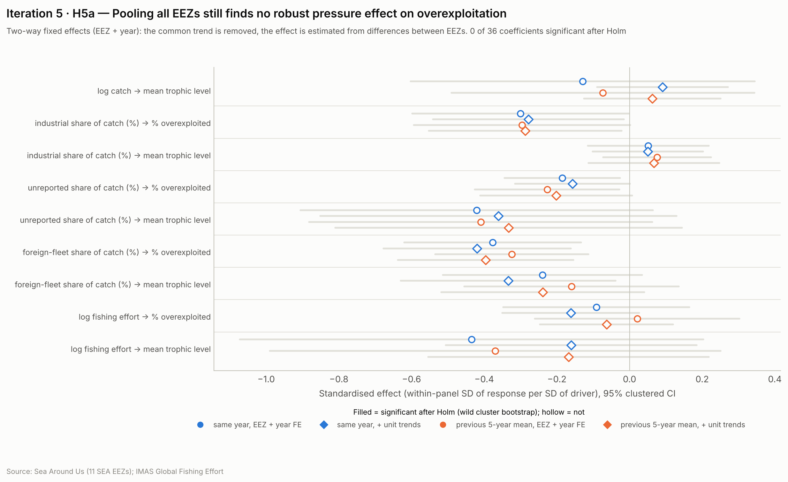 | 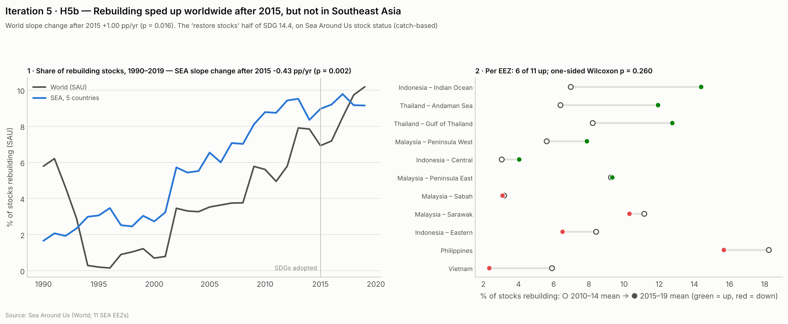 | 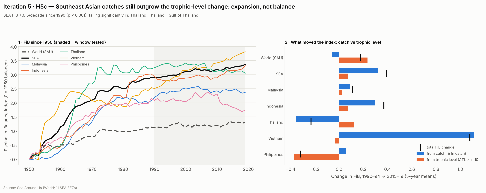 |
| 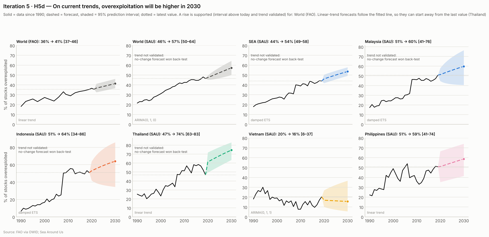 | | |

Tables: `11_I5_H5a_panel_fixed_effects.csv`, `11_I5_H5b_rebuilding_by_eez.csv`, `11_I5_H5b_rebuilding_trends.csv`, `11_I5_H5c_fishing_in_balance.csv`, `11_I5_H5d_forecast_backtest.csv`, `11_I5_H5d_forecast_2030.csv`, `11_I5_H5d_forecast_all_models.csv`, `11_I5_H5d_forecast_paths.csv`. Verdicts are rows in `decisions.csv`. Iteration 5 reads the cleaned table `data/processed/sea_eez_annual.csv` (built by `0-data-quality/clean_data.py`).

## Iteration 6 — drivers in combination (new hypothesis H6)

Iterations 1–5 tested one driver at a time. Two drivers could matter only together: small effects can add up, one driver can mask another, or the effect of one can depend on the level of the other. Iteration 6 tests that in three ways:
- **H6a (pairs, world):** all 28 pairs of the 8 world drivers from S.01. Joint Newey-West (HAC) F-test that both coefficients are zero, Holm within specification, for FAO and Sea Around Us.
- **H6b (interactions, SEA):** 4 pairs chosen in advance on ecological grounds, in the 5-country panel 1960–2017 with country and year fixed effects:
  - effort × sea temperature
  - effort × aquaculture
  - effort × foreign-fleet share
  - industrial share × sea temperature

  The interaction term is tested with both main effects held constant (wild cluster bootstrap, Holm across 16).
- **H6c (best combination, world):** all 64 combinations of the 6 long-run drivers (catch, effort, SST, ocean heat, dams, aquaculture), ranked by BIC, plus LASSO. The real test is held-out years: each year is predicted from a model fitted only on the years before it, with the driver choice redone each time. Shapley R² splits the explained variation fairly between overlapping drivers.

| Test | Result |
|---|---|
| **H6a pairs** | **Weak, not supported in both sources.** Year-to-year changes (the main test): **0 of 28 pairs significant in FAO**. In Sea Around Us, 10 of 28 are significant, but every one contains container traffic or seaborne trade (2000–2019, n ≈ 19), and both are already significant alone in that window. Pairing adds nothing; it is a short-window effect seen in one source only. Only 1 pair test is significant where neither driver is alone. |
| | **Levels with a trend are spurious.** 51 of 112 level F-tests look significant, and single drivers flip sign between specifications (effort: −79 in FAO with a quadratic trend, +35 in SAU with a quadratic trend). Only 4 pass the Engle-Granger cointegration check, all in FAO and none in SAU, so no levels result holds in both sources. |
| **H6b interactions** | **Fail to reject H₀.** 0 of 16 interaction terms significant after Holm. The smallest raw p is effort × sea temperature → mean trophic level (p = 0.046, Holm 0.73), and it vanishes once each country gets its own trend (p = 0.81). |
| **H6c best combination** | **Fail to reject H₀.** All 6 drivers together explain 17% (FAO) and 15% (SAU) of year-to-year changes. A circular-shift permutation (p = 0.23 and 0.47) shows that is no more than chance, although the HAC F-test says p = 0.01–0.02. BIC keeps no driver for FAO, and catch alone for SAU, which is partly circular because SAU stock status is derived from catch. On held-out years the trend alone predicts best in both sources: RMSE 1.45 pp FAO and 0.95 pp SAU, against 1.60 and 0.99 pp for the BIC model. LASSO and the 6-driver model are also worse than trend only. |

**What the sixth iteration adds:**
- The "no driver" result of iterations 1–5 is not an artefact of testing one at a time. No pair, interaction or combination explains overexploitation in both data sources, or predicts unseen years better than the trend.
- It confirms why the analysis works on changes, not levels. With trending series, a levels regression with a trend finds "links" for about half of all pairs, and they are spurious.
- The remaining reading is still slow, cumulative depletion. Overexploitation rises steadily, and yearly fluctuations in pressure, warming or human use don't move it.

**Method choices:**
- **Year-to-year changes as the main test.** Differenced series are stationary (O.02), so a joint F-test on them is valid. A levels result counts only if the same model is cointegrated (Engle-Granger, MacKinnon p, Holm), i.e. its residual is stationary.
- **Joint F-test with HAC covariance** rather than two separate t-tests. It asks the actual question ("do these two add anything together?") and keeps the false-positive rate right when the residuals are autocorrelated.
- **Interactions only in the panel, and only for pre-chosen pairs.** One world series of about 45 years cannot estimate interactions reliably, and testing all 28 × lags would make a chance hit almost certain. Drivers are centred before multiplying, so the main effects stay interpretable. Main effects and fixed effects are partialled out (Frisch-Waugh-Lovell) before the wild cluster bootstrap.
- **BIC + held-out years + LASSO** rather than in-sample fit alone. With 64 candidate models, the best in-sample fit is always optimistic. Redoing the choice inside every training window gives an honest test.
- **Circular-shift permutation** for the joint R². It rotates the drivers against the response, keeping each series' autocorrelation and the drivers' correlation with each other, which a plain shuffle would destroy. Here it is more trustworthy than the HAC F-test, which is too liberal with 6 regressors on about 45 years.
- **Shapley R²:** the only way to split explained variation between correlated drivers that doesn't depend on the order they are added.

| | | |
|---|---|---|
| 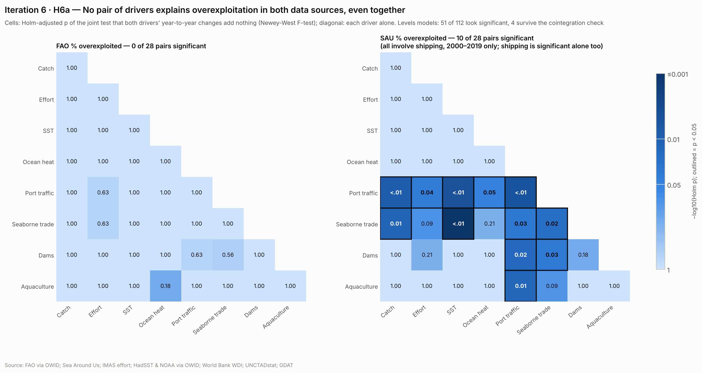 | 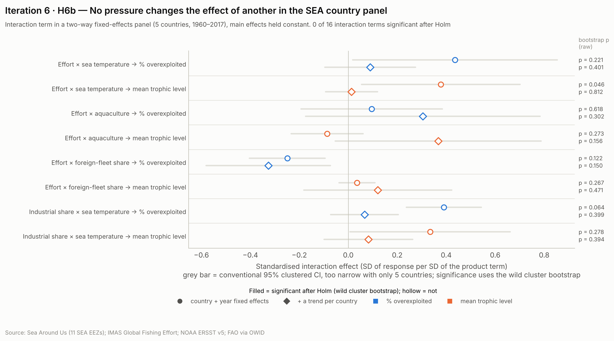 | 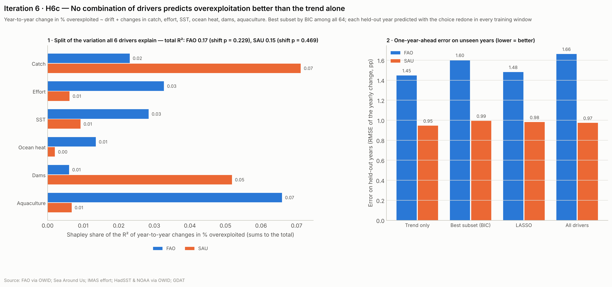 |

Tables: `12_I6_H6a_pairs.csv`, `12_I6_H6a_single_drivers.csv`, `12_I6_H6b_interactions.csv`, `12_I6_H6c_best_combination.csv`, `12_I6_H6c_shapley_r2.csv`, `12_I6_H6c_rolling_origin_predictions.csv`. Verdicts are rows in `decisions.csv`.

## Summary across iterations — all drivers on one method

For the report, `summary` puts the 8 world drivers from iterations 1–4 (catch, effort, sea-surface temperature, ocean heat content, container traffic, seaborne trade, dams, aquaculture) through the same tests: Spearman ρ in levels, after a linear and a quadratic detrend (Holm across all 16 driver × source pairs), and the CCF of growth rates vs Δ% overexploited (lags 0 to n/3, Holm within pair and across all 162 lag tests).

- **Levels:** ρ = +0.71 to +1.00 for every driver — the shared upward trend.
- **Beyond the trend:** no driver is significant with the same sign in both FAO and Sea Around Us under both detrends. Catch and dams hold up in FAO but reverse or vanish in Sea Around Us (dams +0.56 vs −0.65).
- **Year to year:** 0 of 162 lag tests significant across all; the strongest within-pair hit (aquaculture → SAU, Holm p = 0.044) falls away under the full correction (p = 0.65).

Values can differ slightly from the per-iteration tables, which use driver-specific transformations (e.g. source-break removal for effort). Figure S.01 replaces I3.01 and I4.01 in the report's main body.

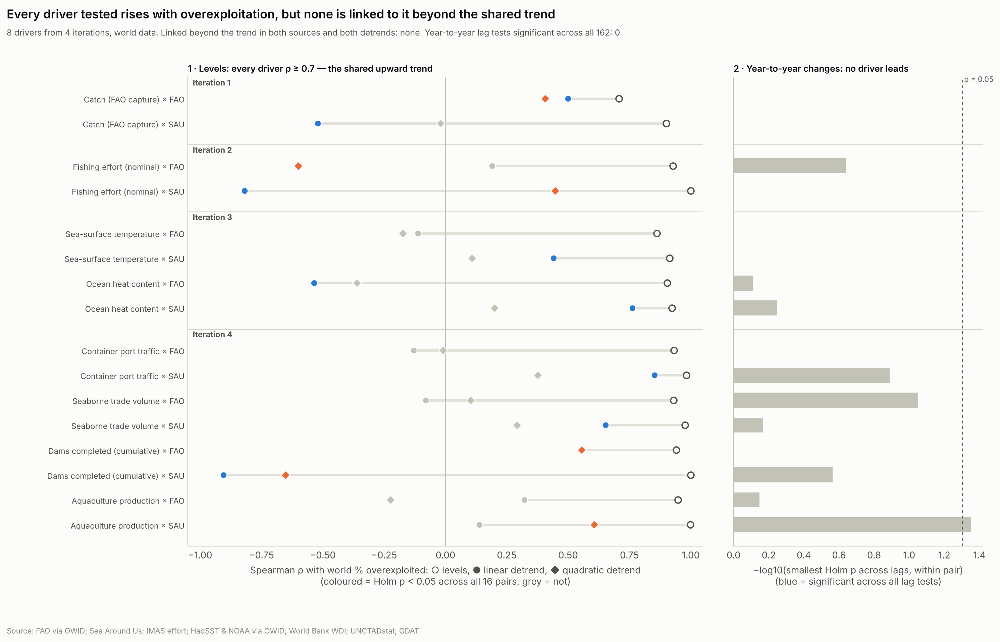

Tables: `10_summary_all_drivers.csv`, `10_summary_all_drivers_ccf.csv`.

## Sections

| Section | Tests | Table(s) | Figure |
|---|---|---|---|
| Stationarity | ADF (H₀ unit root) + KPSS (H₀ stationary) on levels and on the transformation used: first difference / log-difference, detrended if ADF still fails | `0_stationarity_adf_kpss.csv` | — |
| H1a | Mann-Kendall (original + Hamed-Rao), Sen's slope + 95% CI, OLS + Newey-West, segmented regression (break 2015), Chow test | `1_H1a_*.csv` | H1a.01 |
| H1b | CCF lags 0–10 + Holm, AR prewhitening, Granger (F-test, lags 1–4), Engle-Granger cointegration | `2_H1b_*.csv` | H1b.01 |
| H2a | Hamed-Rao Mann-Kendall + Sen's slope for SEA, 5 countries and 11 EEZs × 2 windows, Holm per family; FAO Areas 71/57 | `3_H2a_*.csv` | H2a.01 |
| H2b | CCF catch growth → ΔMTL for SEA + 5 countries, Holm within unit and across all 66 tests | `4_H2b_ccf_catch_mtl.csv` | H2b.01 |
| H2c | Interaction regression y = b0 + b1·year + b2·SEA + b3·year×SEA; b3 tested on the SEA − world gap with HAC errors | `5_H2c_interaction_gap_regression.csv` | H2c.01 |
| Diagnostics | Shapiro-Wilk, Durbin-Watson, Ljung-Box, Breusch-Pagan for every regression | `6_regression_diagnostics.csv` | D.01 |

## Figures

| | |
|---|---|
| 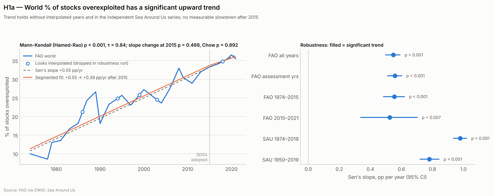 | 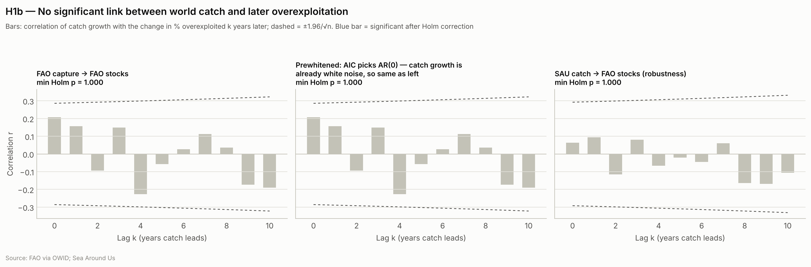 |
| 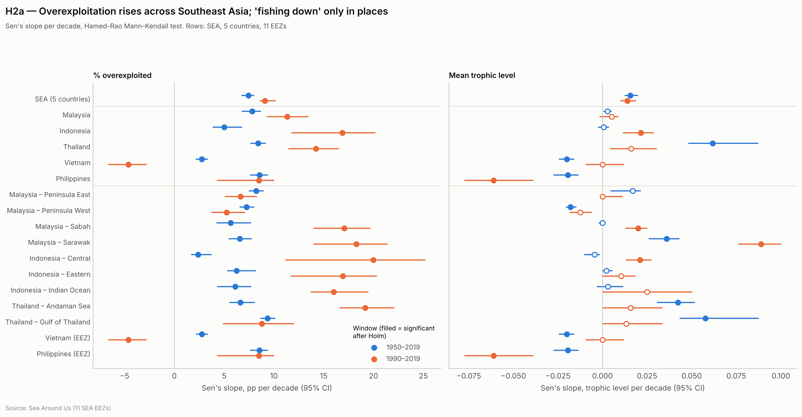 | 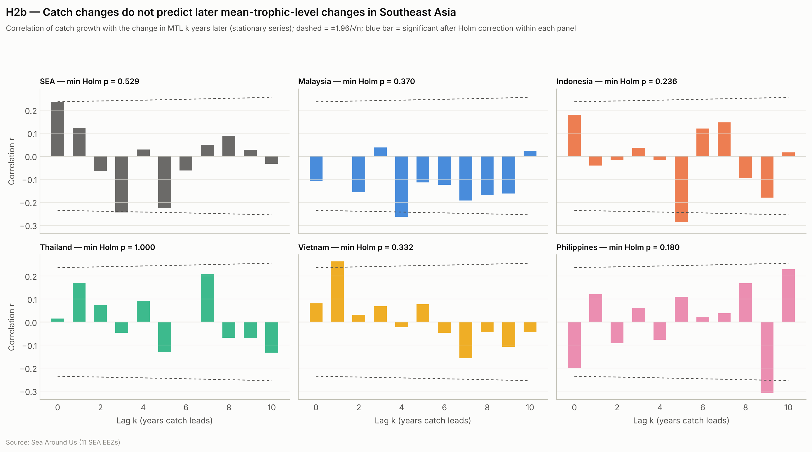 |
| 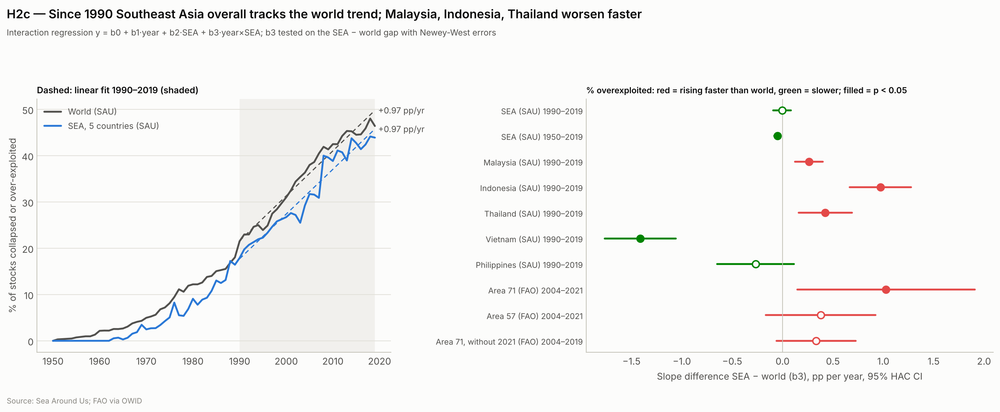 | 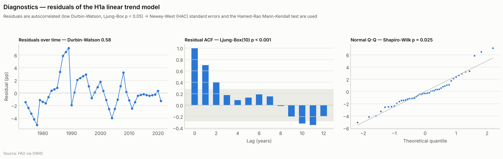 |

## Notes for the report

- **Autocorrelation:** the H1a residuals have Durbin-Watson 0.58 and Ljung-Box p < 0.001, and 8 of the 13 regressions fail Ljung-Box. That is why every regression uses HAC standard errors and every trend uses the Hamed-Rao Mann-Kendall test.
- **Non-normal residuals:** these occur in the H1a and SEA-gap regressions (Shapiro p < 0.05). This supports Mann-Kendall / Sen as the primary trend evidence; OLS is the secondary check.
- **KPSS disagreements:** 7 transformed series pass ADF but not KPSS (flagged in the stationarity table). The CCF results there are the least certain, but none was close to significance.
- **SEA aggregate:** % overexploited is the mean of the 5 countries, so each country counts equally. A mean over the 11 EEZs would give Malaysia (4 EEZs) and Indonesia (3) more weight, and SEA would then look worse than the world.
- **FAO Area 71 vs world:** this comparison uses only 10 assessment years. The 2021 value (47%, up from 20% in 2019) drives the significance.
